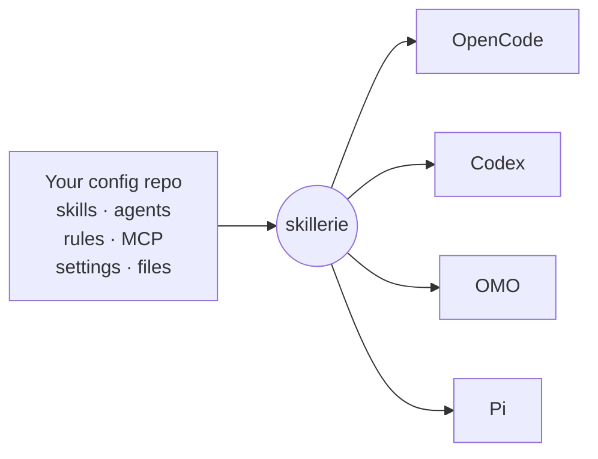

<p align="center">
  
</p>

<h1 align="center">skillerie</h1>

<p align="center">
  <b>Your whole coding-agent setup in one repo, synced to every harness.</b>
</p>

<p align="center">
  <a href="https://www.npmjs.com/package/skillerie"></a>
  <a href="https://github.com/e-n-0/skillerie/actions/workflows/ci.yml"></a>
  <a href="https://github.com/e-n-0/skillerie/blob/main/package.json"></a>
  <a href="LICENSE"></a>
</p>

<p align="center">
  <a href="#quickstart">Quickstart</a> ·
  <a href="#set-up-with-your-coding-agent">Set up with your agent</a> ·
  <a href="docs/config.md">Docs</a>
</p>

skillerie keeps your coding-agent setup in one git repository: skills, agents, rules, instructions, MCP servers, and each harness's own settings files, plugins and extensions. It renders native configuration for [OpenCode](https://opencode.ai), [Codex](https://github.com/openai/codex), [OMO](https://github.com/code-yeongyu/oh-my-openagent) and [Pi](https://pi.dev) and installs it, so every harness on every machine stays in sync.



## Why skillerie

- Write a skill once in plain Markdown. skillerie translates tool names, question tools, sub-agents and skill references into what each harness understands.
- Keep each harness's settings (`opencode.jsonc`, Codex `config.toml`, OMO and Pi settings), plugins, extensions and other files in the same repo. skillerie merges them with what it generates, so a new machine gets your exact setup with one `install`.
- Load community skills straight from GitHub, pinned to a tag or commit, and run `skillerie outdated` to see when upstream moves.
- Dry-run every install. skillerie backs up anything it replaces, leaves your manual edits alone, and `skillerie uninstall` undoes it all.
- `validate` catches broken references and invalid frontmatter, and `doctor` has Codex and OpenCode check the config skillerie renders for them.

## Quickstart

Requires Node 22 or newer on macOS or Linux.

```sh
npx skillerie init my-agents     # enables the harnesses found on your PATH
cd my-agents
npx skillerie install --check    # show the plan, write nothing
npx skillerie install
```

Add skills under `skills/<name>/SKILL.md`, or pull them from GitHub:

```yaml
# skillerie.yaml
skills:
  external:
    - url: https://github.com/openai/skills/tree/main/skills/.curated/gh-fix-ci
```

Harness settings files go under `harnesses/<harness>/templates/`, and plugins or extensions under `harnesses/<harness>/assets/`. Run `npx skillerie install` again after every change.

## Set up with your coding agent

Paste this into Claude Code, Codex, OpenCode or any other coding agent:

```text
Set up skillerie for me by following
https://raw.githubusercontent.com/e-n-0/skillerie/main/docs/agent-setup.md
Bring in the skills and agents I already have, show me the install plan,
and ask me before installing anything.
```

## Supported harnesses

<!-- prettier-ignore -->
| Harness | Installs into |
|-|-|
| [OpenCode](docs/harnesses/opencode.md) | `~/.config/opencode` |
| [Codex](docs/harnesses/codex.md) | `~/.codex` |
| [OMO](docs/harnesses/omo.md) | `~/.omo` |
| [Pi](docs/harnesses/pi.md) | `~/.pi/agent` |

## Documentation

- [Configuration](docs/config.md): every `skillerie.yaml` key, external skills, MCP servers
- [Authoring](docs/authoring.md): the shared Markdown dialect and how each harness translates it
- [Install and safety model](docs/install.md): commands, backups, ownership, uninstall
- [Agent setup guide](docs/agent-setup.md): how a coding agent sets skillerie up for you

skillerie is pre-1.0: the config format is versioned, but minor releases may still change behavior.

## Contributing

Contributions are welcome. See [CONTRIBUTING.md](CONTRIBUTING.md), and report security issues as described in [SECURITY.md](SECURITY.md).

Licensed under [Apache-2.0](LICENSE).
